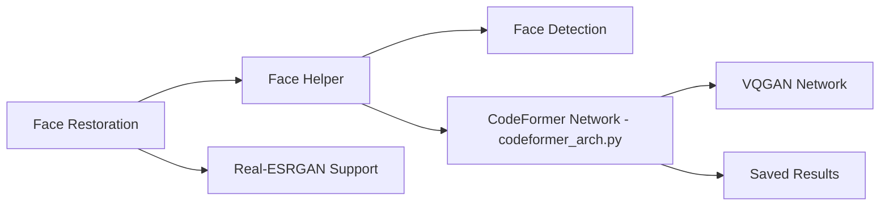

# sczhou/CodeFormer

> Model for restoring blurry or damaged faces (NeurIPS 2022), with colorization and inpainting scripts.

## The problem
Restoring degraded faces in photos or videos without losing their identity.

## What it actually does
A codebook-lookup transformer restores faces with a fidelity weight `w` between 0 and 1. Scripts for whole images (detection, alignment, recomposition), video, colorization and inpainting of cropped faces. Optional Real-ESRGAN for the background. Training code published.

## How it is wired


## Trying it
```bash
git clone https://github.com/sczhou/CodeFormer
cd CodeFormer
conda create -n codeformer python=3.8 -y
conda activate codeformer
pip3 install -r requirements.txt
python basicsr/setup.py develop
python scripts/download_pretrained_models.py CodeFormer
python inference_codeformer.py -w 0.7 --input_path [image folder]|[image path]
```

## Cost and gotchas
Free. PyTorch ≥ 1.7.1 and CUDA ≥ 10.1. Many unofficial third-party sites use the model: the README warns against scams.

## What it is not
Only the Hugging Face, Replicate and OpenXLab demos are official. License not identified by GitHub: commercial use remains to be verified.

## Alternatives
No alternative named in the README (Real-ESRGAN is used there as a component).

## For you
Watch: effective face restoration for a vision project, but an old stack and an unclear license before any product use.
