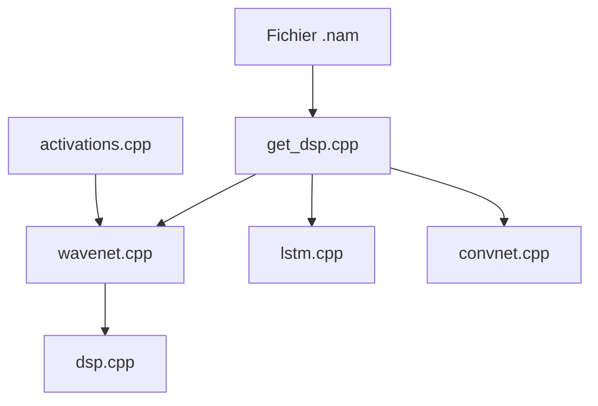

# sdatkinson/NeuralAmpModelerCore

> C++ signal-processing library that runs neural models simulating guitar amplifiers.

## The problem
Playing a trained `.nam` model in real time requires a lightweight audio inference engine, inside a plugin.

## What it actually does
Loads a `.nam` file and runs it with WaveNet, LSTM or ConvNet networks, relying on Eigen for linear algebra and nlohmann/json for configuration. Three tools are provided: `run_tests`, `loadmodel`, `benchmodel`. The library is the core of the NeuralAmpModelerPlugin plugin.

## How it is wired


## Trying it
```bash
# Aucune commande dans le README : voir .github/workflows/build.yml
# pour compiler run_tests, loadmodel et benchmodel.
```

## Cost and gotchas
Free. Risk of Eigen memory-alignment problems depending on the compiler; workaround with `EIGEN_MAX_ALIGN_BYTES 0` and `EIGEN_DONT_VECTORIZE`, at the cost of speed (issue 67).

## What it is not
Not a training tool nor a complete audio plugin.

## Alternatives
No alternative named in the README.

## For you
Ignore: an example of real-time neural inference in C++, but confined to guitar audio.
