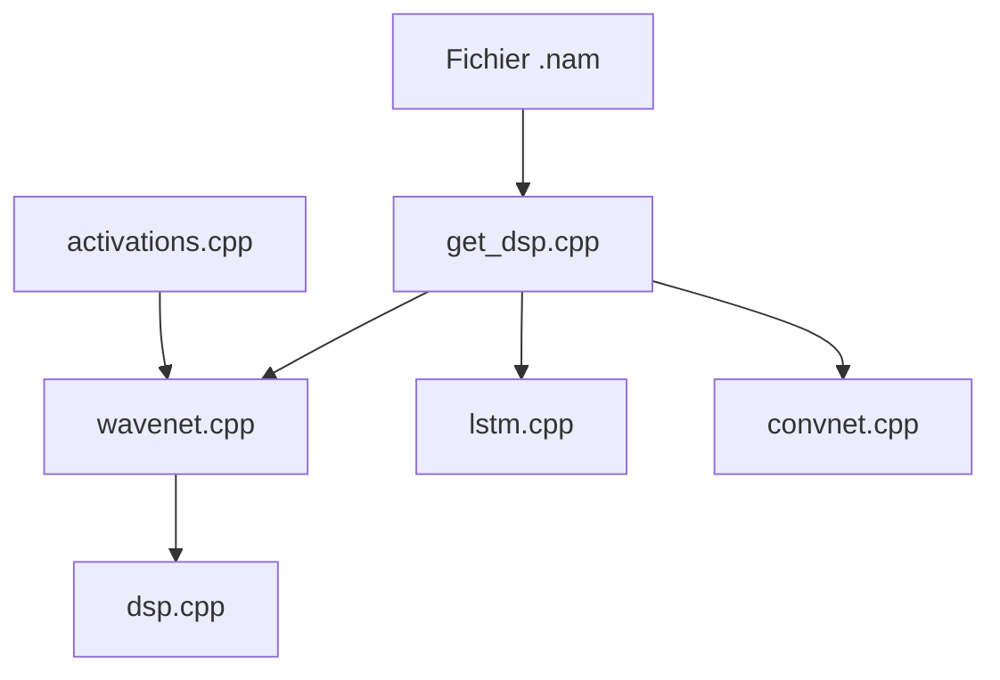

# sdatkinson/NeuralAmpModelerCore

> Bibliothèque C++ de traitement du signal qui exécute des modèles neuronaux de simulation d'ampli guitare.

## Le problème
Jouer en temps réel un modèle `.nam` entraîné demande un moteur d'inférence audio léger, dans un greffon.

## Ce que ça fait vraiment
Charge un fichier `.nam` et l'exécute avec des réseaux WaveNet, LSTM ou ConvNet, en s'appuyant sur Eigen pour l'algèbre linéaire et sur nlohmann/json pour la configuration. Trois outils sont fournis : `run_tests`, `loadmodel`, `benchmodel`. La bibliothèque sert de cœur au greffon NeuralAmpModelerPlugin.

## Comment c'est branché


## Essayer
```bash
# Aucune commande dans le README : voir .github/workflows/build.yml
# pour compiler run_tests, loadmodel et benchmodel.
```

## Coût et pièges
Gratuit. Risque d'alignement mémoire d'Eigen selon le compilateur ; contournement par `EIGEN_MAX_ALIGN_BYTES 0` et `EIGEN_DONT_VECTORIZE`, au prix de la vitesse (ticket 67).

## Ce que ce n'est pas
Pas un outil d'entraînement ni un greffon audio complet.

## Alternatives
Aucune alternative nommée dans le README.

## Pour toi
Ignorer : exemple d'inférence neuronale temps réel en C++, mais cantonné à l'audio de guitare.

