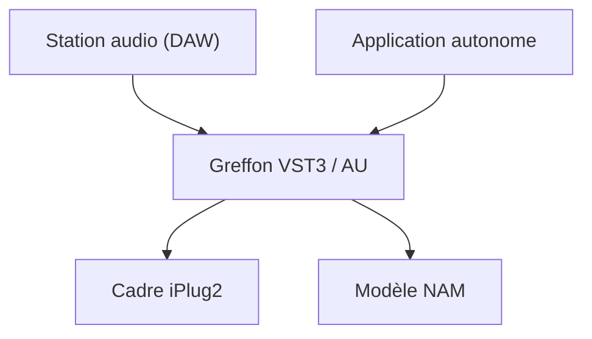

# sdatkinson/NeuralAmpModelerPlugin

> VST3 and AudioUnit plugin that runs Neural Amp Modeler models of guitar amps.

## The problem
Using a guitar amp modeled by a neural network inside music software.

## What it actually does
Plugin built with iPlug2, usable in a digital audio workstation or as a standalone application. It loads NAM models from the neural-amp-modeler project. The README mentions possible upcoming support for AAX, CLAP, Linux and iOS.

## How it is wired
Simplified diagram based on the fiche, no diagram provided.

## Trying it
No command in the README: the build scripts are in NeuralAmpModeler/scripts/ and the workflows show the procedure.

## Cost and gotchas
Free, but you must build it yourself; precompiled installers exist via "Gateway", a fork by the author. A crash before the interface appears can come from a wrong graphics card choice on Windows.

## What it is not
Not a training tool: training belongs to the neural-amp-modeler repository. The standalone application's inputs and outputs are limited compared to a plugin host.

## Alternatives
Not documented in the README, except the Gateway fork for installers.

## For you
Ignore: musical audio domain, relevant only if you do neural-network inference on real-time audio signals.
