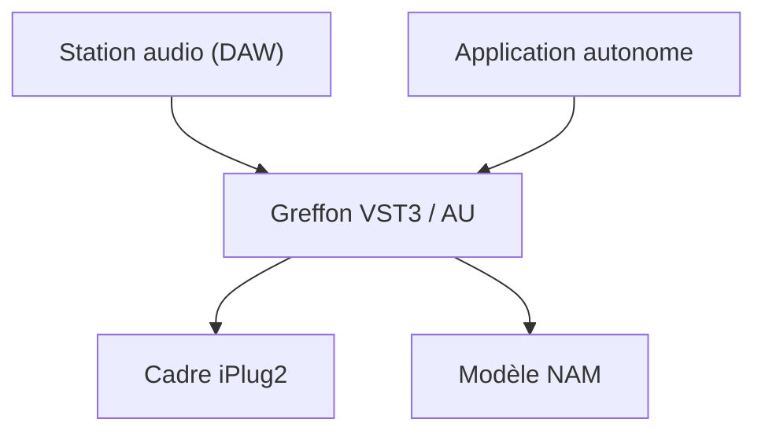

# sdatkinson/NeuralAmpModelerPlugin

> Greffon VST3 et AudioUnit qui fait tourner des modèles Neural Amp Modeler d'amplis de guitare.

## Le problème
Utiliser dans un logiciel de musique un ampli de guitare modélisé par réseau de neurones.

## Ce que ça fait vraiment
Greffon construit avec iPlug2, utilisable dans une station audio ou en application autonome. Il charge des modèles NAM issus du projet neural-amp-modeler. Le README annonce un possible support AAX, CLAP, Linux et iOS à venir.

## Comment c'est branché
Schéma simplifié d'après la fiche, sans diagramme fourni.

## Essayer
Aucune commande dans le README : les scripts de build sont dans NeuralAmpModeler/scripts/ et les workflows montrent la marche à suivre.

## Coût et pièges
Gratuit, mais à compiler soi-même ; des installateurs précompilés existent via « Gateway », un fork de l'auteur. Un plantage avant l'interface peut venir d'un mauvais choix de carte graphique sous Windows.

## Ce que ce n'est pas
Pas un outil d'entraînement : l'entraînement relève du dépôt neural-amp-modeler. Les entrées-sorties de l'application autonome sont limitées par rapport à un hôte de greffons.

## Alternatives
Non documenté dans le README, sauf le fork Gateway pour les installateurs.

## Pour toi
À ignorer : domaine audio musical, pertinent seulement si tu fais de l'inférence de réseaux de neurones sur du signal audio en temps réel.

