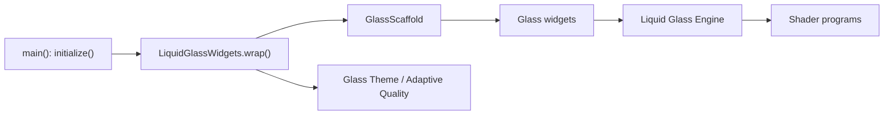

# sdegenaar/liquid_glass_widgets

> Flutter package of iOS 26/27-style "Liquid Glass" widgets, with shaders, real blur and spring animations.

## The problem
Reproducing iOS's liquid glass effect in Flutter requires hand-written shaders and physics.

## What it actually does
Provides containers, controls, fields, overlays and navigation surfaces (`GlassScaffold`, `GlassAppBar`, `GlassTabBar`). Three quality levels (minimal, standard, premium) with adaptive switching depending on the device (experimental). Accessibility (Reduce Motion, contrast) and RTL are supported. No third-party `pubspec` dependency; the rendering engine builds on `liquid_glass_renderer`.

## How it is wired


## Trying it
```bash
flutter pub get
```
Add `liquid_glass_widgets: ^1.14.2` to `pubspec.yaml`, then in `main()`: `await LiquidGlassWidgets.initialize();` and `runApp(LiquidGlassWidgets.wrap(child: const MyApp()));`.

## Cost and gotchas
Free. Requires Flutter 3.41+. Premium mode only suits static surfaces (doubtful rendering inside a `ListView`). Under `MaterialApp`, you must provide a brightness resolver and a `Material` ancestor.

## What it is not
Not a general-purpose component library: glass is reserved for navigation, not lists. The adaptive thresholds still need calibration.

## Alternatives
- liquid_glass_renderer (whynotmake-it): the rendering engine this package derives from, lower-level.

## For you
Ignore: a mobile UI library unrelated to data/AI/MLOps, useful only if you are building a Flutter app.
