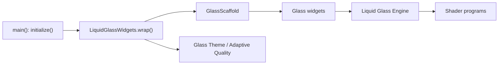

# sdegenaar/liquid_glass_widgets

> Paquet Flutter de widgets « Liquid Glass » style iOS 26/27, avec shaders, flou réel et animations à ressort.

## Le problème
Reproduire l'effet de verre liquide d'iOS dans Flutter demande des shaders et une physique écrits à la main.

## Ce que ça fait vraiment
Fournit conteneurs, contrôles, champs, overlays et surfaces de navigation (`GlassScaffold`, `GlassAppBar`, `GlassTabBar`). Trois niveaux de qualité (minimal, standard, premium) avec bascule adaptative selon l'appareil (expérimentale). Accessibilité (Reduce Motion, contraste) et RTL pris en charge. Aucune dépendance `pubspec` tierce ; le moteur de rendu reprend `liquid_glass_renderer`.

## Comment c'est branché


## Essayer
```bash
flutter pub get
```
Ajouter `liquid_glass_widgets: ^1.14.2` à `pubspec.yaml`, puis dans `main()` : `await LiquidGlassWidgets.initialize();` et `runApp(LiquidGlassWidgets.wrap(child: const MyApp()));`.

## Coût et pièges
Gratuit. Flutter 3.41+ requis. Le mode premium ne convient qu'aux surfaces statiques (rendu douteux dans `ListView`). Sous `MaterialApp`, il faut fournir un résolveur de luminosité et un ancêtre `Material`.

## Ce que ce n'est pas
Pas une bibliothèque de composants généraliste : le verre est réservé à la navigation, pas aux listes. Les seuils adaptatifs sont encore à calibrer.

## Alternatives
- liquid_glass_renderer (whynotmake-it) : moteur de rendu dont ce paquet est dérivé, plus bas niveau.

## Pour toi
À ignorer : bibliothèque d'interface mobile sans lien avec data/IA/MLOps, utile uniquement si tu construis une app Flutter.

