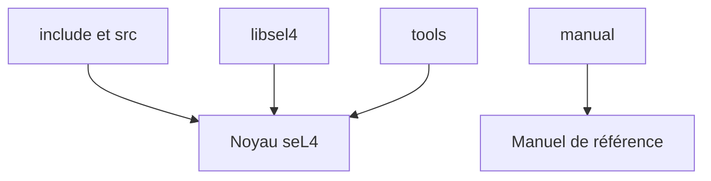

# seL4/seL4

> Operating system microkernel with a formal proof of correctness, for designers of critical systems.

## The problem
Conventional kernels are too big to be proven safe, while critical systems demand strong isolation guarantees.

## What it actually does
Contains the C and assembly source of the seL4 microkernel, its build tools, the `libsel4` C bindings of the ABI, and the LaTeX sources of the manual. The README points to the website for the proof of correctness. The repo is rarely used alone: it is part of a larger build system.

## How it is wired
Simplified diagram based on the sheet, no diagram provided.

## Trying it
Build instructions are not in the README: it points to the seL4 website (host dependencies, build system).

## Cost and gotchas
Free, but requires a toolchain and an external build system. The license in LICENSE.md is not identified by GitHub (the header cites GPL-2.0-only).

## What it is not
Not a usable operating system: a bare microkernel, with no drivers or applications. Not a data science tool.

## Alternatives
No alternative named in the README.

## For you
Ignore for a data / AI / MLOps profile: it is low-level system security, far from your everyday needs.
