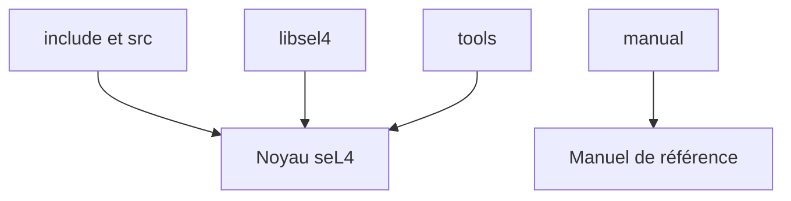

# seL4/seL4

> Micronoyau de système d'exploitation avec preuve formelle de correction, pour concepteurs de systèmes critiques.

## Le problème
Les noyaux classiques sont trop gros pour être prouvés sûrs, alors que des systèmes critiques exigent des garanties fortes d'isolation.

## Ce que ça fait vraiment
Contient le code source C et assembleur du micronoyau seL4, ses outils de build, les liaisons C `libsel4` de l'ABI et les sources LaTeX du manuel. Le README renvoie au site pour la preuve de correction. Le dépôt s'utilise rarement seul : il fait partie d'un système de build plus large.

## Comment c'est branché
Schéma simplifié d'après la fiche, sans diagramme fourni.

## Essayer
Les instructions de build ne sont pas dans le README : il renvoie au site seL4 (dépendances d'hôte, build system).

## Coût et pièges
Gratuit, mais demande une chaîne de compilation et un système de build externe. La licence du fichier LICENSE.md n'est pas identifiée par GitHub (l'en-tête cite GPL-2.0-only).

## Ce que ce n'est pas
Pas un système d'exploitation utilisable : un micronoyau seul, sans pilotes ni applications. Pas un outil pour data science.

## Alternatives
Aucune alternative nommée dans le README.

## Pour toi
À ignorer pour un profil data / IA / MLOps : c'est de la sécurité système bas niveau, loin de tes besoins courants.

