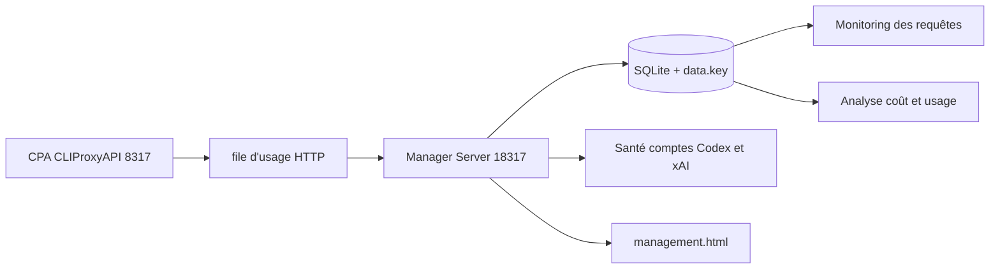

# seakee/CPA-Manager-Plus

> Self-hosted administration and observability panel for the CPA / CLIProxyAPI gateway.

## The problem
An AI gateway sees requests, costs, quotas and failures go by, but does not keep them.
When an account breaks or the bill climbs, there is no trace to inspect.

## What it actually does
Persists the request history in a local SQLite database: status, latency, tokens, cache, trace, redacted failure evidence.
Breaks down calls, tokens, cost, latency and failures by model, provider, account, API key, project, channel and period.
Syncs prices from models.dev, with LiteLLM and OpenRouter as fallbacks and local overrides.
Inspects Codex and xAI accounts: quota windows, reset evidence, recovery action queue.

## How it is wired


## Trying it
```bash
docker run -d \
  --name cpa-manager-plus \
  --restart unless-stopped \
  -p 18317:18317 \
  -v cpa-manager-plus-data:/data \
  seakee/cpa-manager-plus:latest
```

## Cost and gotchas
Free, with no sign-up and no telemetry, but you need a CPA instance at `v7.1.39+` alongside it.
The CPA management keys are encrypted: a backup without the `data.key` file is unusable.

## What it is not
Not a proxy: it administers and observes CPA, it relays no model traffic itself.
Not a connectable demo: the online demonstration uses fictitious data.
Not a mandatory replacement: the lightweight panel can simply stand in for the official UI on `:8317`.

## Alternatives
The official Management Center of CLI Proxy API, to stay on the upstream UI.
The lightweight CPAMP panel, if you want neither an extra service nor an extra database.

## For you
Useful only if you already run CLIProxyAPI; otherwise the pair to install is disproportionate.
