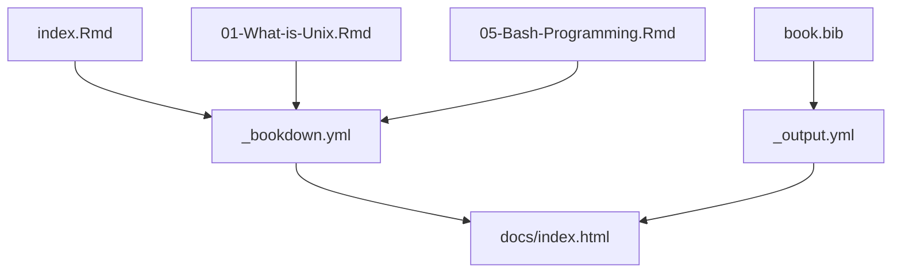

# seankross/the-unix-workbench

> Introductory Unix book for beginners, published online, by Sean Kross.

## The problem
Beginners in data or development lack a foundation in the shell, files and Bash scripts.

## What it actually does
The README only says "An introduction to Unix for everyone" and the CC0 license. Based on the architecture, it is a bookdown book: Rmd chapters (Unix, Bash programming, first projects) assembled via _bookdown.yml and _output.yml, bibliography book.bib, HTML rendering in docs/ for GitHub Pages.

## How it is wired


## Trying it
```bash
# Aucune commande documentée dans le README :
# lire le livre rendu dans docs/ (GitHub Pages).
```

## Cost and gotchas
Free. Last push in August 2024: content possibly a bit dated. Many open issues (381).

## What it is not
Not a tool or an interactive course. Not an advanced command-line book.

## Alternatives
No alternative named in the README.

## For you
Adopt as basic reading if you want to consolidate your shell skills, public domain (CC0), but the README is too thin to judge the quality.
