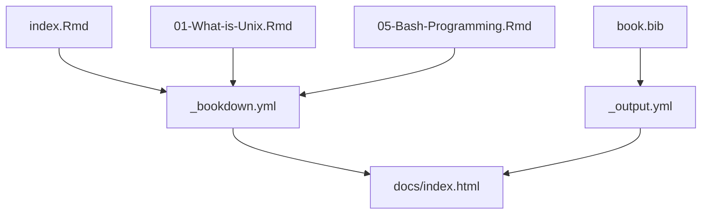

# seankross/the-unix-workbench

> Livre d'introduction à Unix pour débutants, publié en ligne, de Sean Kross.

## Le problème
Les débutants en données ou en développement manquent de base sur le shell, les fichiers et les scripts Bash.

## Ce que ça fait vraiment
Le README ne dit que « An introduction to Unix for everyone » et la licence CC0. D'après l'architecture, c'est un livre bookdown : des chapitres Rmd (Unix, programmation Bash, premiers projets) assemblés via _bookdown.yml et _output.yml, bibliographie book.bib, rendu HTML dans docs/ pour GitHub Pages.

## Comment c'est branché


## Essayer
```bash
# Aucune commande documentée dans le README :
# lire le livre rendu dans docs/ (GitHub Pages).
```

## Coût et pièges
Gratuit. Dernier push en août 2024 : contenu possiblement un peu daté. Beaucoup d'issues ouvertes (381).

## Ce que ce n'est pas
Pas un outil ni un cours interactif. Pas un livre avancé de ligne de commande.

## Alternatives
Aucune alternative nommée dans le README.

## Pour toi
À adopter comme lecture de base si tu veux consolider le shell, domaine libre (CC0), mais README trop mince pour juger de la qualité.

