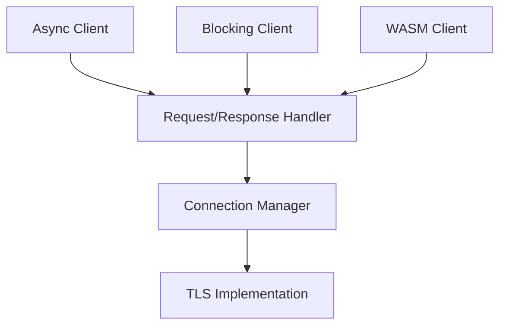

# seanmonstar/reqwest

> Rust HTTP client, async or blocking, for Rust developers.

## The problem
Calling HTTP APIs in Rust with JSON, cookies, proxies and TLS takes a lot of low-level code.

## What it actually does
An async client and a blocking client, with plain, JSON, urlencoded and multipart bodies, configurable redirects, HTTP proxies, cookies, HTTPS via rustls or native TLS, and a WASM target. The code also contains an HTTP/3 client and several DNS resolvers.

## How it is wired


## Trying it
```bash
# Cargo.toml
# reqwest = { version = "0.13", features = ["json"] }
# tokio = { version = "1", features = ["full"] }
```

## Cost and gotchas
Free. Rust is required. On Linux, the `native-tls` feature requires OpenSSL, otherwise compilation fails; `native-tls-vendored` compiles a copy of it.

## What it is not
Not a scraping framework nor a server: it is an HTTP client.

## Alternatives
No alternative named in the README.

## For you
Ignore: useful only if you write Rust; in Python you already have your own HTTP clients.
