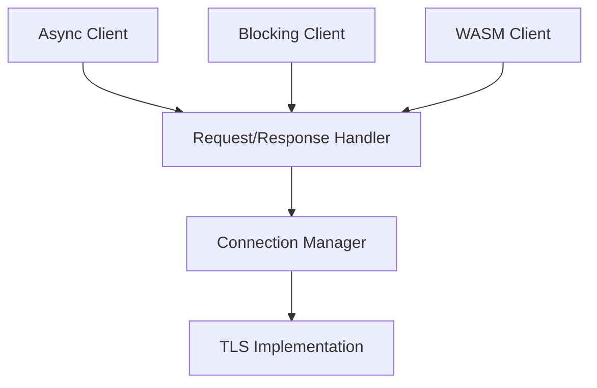

# seanmonstar/reqwest

> Client HTTP Rust, asynchrone ou bloquant, pour développeurs Rust.

## Le problème
Appeler des API HTTP en Rust avec JSON, cookies, proxys et TLS demande beaucoup de code de bas niveau.

## Ce que ça fait vraiment
Un client async et un client bloquant, avec corps simples, JSON, urlencoded et multipart, redirections configurables, proxys HTTP, cookies, HTTPS via rustls ou TLS natif, et cible WASM. Le code contient aussi un client HTTP/3 et plusieurs résolveurs DNS.

## Comment c'est branché


## Essayer
```bash
# Cargo.toml
# reqwest = { version = "0.13", features = ["json"] }
# tokio = { version = "1", features = ["full"] }
```

## Coût et pièges
Gratuit. Rust est nécessaire. Sous Linux, la fonctionnalité `native-tls` exige OpenSSL, sinon la compilation échoue ; `native-tls-vendored` en compile une copie.

## Ce que ce n'est pas
Pas un framework de scraping ni un serveur : c'est un client HTTP.

## Alternatives
Aucune alternative nommée dans le README.

## Pour toi
À ignorer : utile seulement si tu écris en Rust ; en Python tu as déjà tes propres clients HTTP.

