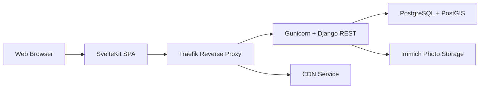

# seanmorley15/AdventureLog

> Self-hosted travel journal and planning application, with a world map.

## The problem
Travel apps lock your data in with a vendor and fragment journal, itineraries and statistics.

## What it actually does
Places and visits with photos, multi-day itineraries, interactive map, tracking of countries and regions, GPX tracks, sharing and collaborative editing. Integrations with Immich, Strava, Endurain, Wanderer, Google Maps. SvelteKit frontend, Django REST backend with PostGIS, MFA and social authentication.

## How it is wired


## Trying it
```bash
curl -sSL https://get.adventurelog.app | bash
```

## Cost and gotchas
Free. Docker Engine + Compose v2 and 2 GB of RAM at first startup. Default credentials `admin` / `admin`: change them. The README shows GPL-3.0 but GitHub does not identify the license: to be verified. A remote script run via `curl | bash`.

## What it is not
Not a hosted service. Geocoding goes through Google Maps: a third-party service that may have its own terms.

## Alternatives
No alternative named in the README.

## For you
Worth watching: a good example of a self-hostable Django/SvelteKit/PostGIS stack, useful for personal use; outside the professional scope.
