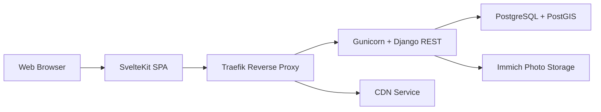

# seanmorley15/AdventureLog

> Application auto-hébergée de journal et planification de voyages, avec carte du monde.

## Le problème
Les applications de voyage verrouillent tes données chez un éditeur et morcellent journal, itinéraires et statistiques.

## Ce que ça fait vraiment
Lieux et visites avec photos, itinéraires multi-jours, carte interactive, suivi des pays et régions, pistes GPX, partage et édition collaborative. Intégrations Immich, Strava, Endurain, Wanderer, Google Maps. Frontend SvelteKit, backend Django REST avec PostGIS, authentification MFA et sociale.

## Comment c'est branché


## Essayer
```bash
curl -sSL https://get.adventurelog.app | bash
```

## Coût et pièges
Gratuit. Docker Engine + Compose v2 et 2 Go de RAM au premier démarrage. Identifiants par défaut `admin` / `admin` : à changer. Le README affiche GPL-3.0 mais GitHub n'identifie pas la licence : à vérifier. Un script distant exécuté via `curl | bash`.

## Ce que ce n'est pas
Pas un service hébergé. Géocodage via Google Maps : un service tiers qui peut avoir ses conditions.

## Alternatives
Aucune alternative nommée dans le README.

## Pour toi
Surveiller : bon exemple de stack Django/SvelteKit/PostGIS auto-hébergeable, utile pour un usage personnel ; hors périmètre professionnel.

