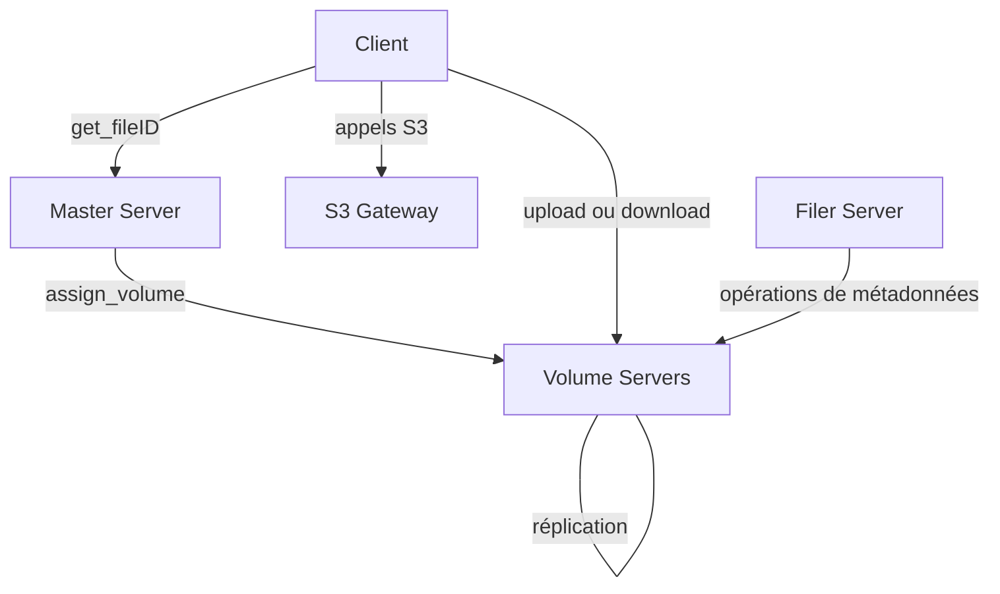

# seaweedfs/seaweedfs

> Distributed file system that also serves an S3 API, to store billions of files.

## The problem
Conventional object or file storage suffers from large numbers of small files, and MinIO, according to the README, stopped development in April 2026.

## What it actually does
A single `weed` binary serves S3 object storage, a POSIX file system, WebDAV, SFTP and an Iceberg REST catalog. Volume servers store blobs in append-only files with a 16-byte in-memory index. Masters track volumes, not files. The filer adds directories on top of the metadata store of your choice. It offers replication, erasure coding for warm data, caching and cloud tiering, S3 Tables with Iceberg or Lance.

## How it is wired


## Trying it
```bash
AWS_ACCESS_KEY_ID=admin \
AWS_SECRET_ACCESS_KEY=secret \
S3_BUCKET=my-bucket \
./weed mini -dir=./data

AWS_ACCESS_KEY_ID=admin AWS_SECRET_ACCESS_KEY=secret \
  aws --endpoint-url http://localhost:8333 s3 cp README.md s3://my-bucket/
```

## Cost and gotchas
Free under Apache-2.0; a paid enterprise edition exists. The installation offers a `curl | bash`. Without an admin password or mTLS, the admin interface stays bound to the loopback. For production, plan for three masters and a metadata database.

## What it is not
It is not a like-for-like MinIO replacement on every point: the README admits SeaweedFS is still catching up on the interface and some features. Data balancing is not automatic.

## Alternatives
RustFS (a MinIO reimplementation in Rust), Ceph (more complex, with CRUSH hashing), HDFS (suited to large files).

## For you
Worth watching for local S3 storage or an Iceberg data lake: solid, but running a cluster remains a real undertaking.
