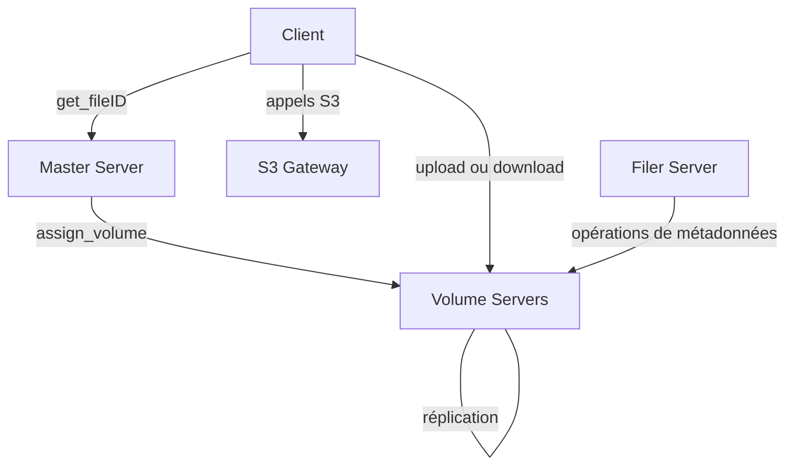

# seaweedfs/seaweedfs

> Système de fichiers distribué qui sert aussi une API S3, pour stocker des milliards de fichiers.

## Le problème
Les stockages objet ou fichiers classiques pâtissent des petits fichiers en grand nombre, et MinIO, selon le README, a cessé son développement en avril 2026.

## Ce que ça fait vraiment
Un seul binaire `weed` sert un objet S3, un système POSIX, WebDAV, SFTP et un catalogue Iceberg REST. Les volume servers stockent des blobs en fichiers append-only avec un index de 16 octets en mémoire. Les masters suivent les volumes, pas les fichiers. Le filer ajoute les répertoires sur le magasin de métadonnées de ton choix. Il propose réplication, codage d'effacement des données tièdes, cache et tiering cloud, S3 Tables avec Iceberg ou Lance.

## Comment c'est branché


## Essayer
```bash
AWS_ACCESS_KEY_ID=admin \
AWS_SECRET_ACCESS_KEY=secret \
S3_BUCKET=my-bucket \
./weed mini -dir=./data

AWS_ACCESS_KEY_ID=admin AWS_SECRET_ACCESS_KEY=secret \
  aws --endpoint-url http://localhost:8333 s3 cp README.md s3://my-bucket/
```

## Coût et pièges
Gratuit sous Apache-2.0 ; une édition entreprise payante existe. L'installation propose un `curl | bash`. Sans mot de passe d'admin ni mTLS, l'interface d'admin reste liée à la boucle locale. Pour la production, prévoir trois masters et une base de métadonnées.

## Ce que ce n'est pas
Ce n'est pas un remplaçant à l'identique de MinIO sur tous les points : le README admet que SeaweedFS rattrape encore l'interface et certaines fonctions. L'équilibrage des données n'est pas automatique.

## Alternatives
RustFS (réimplémentation de MinIO en Rust), Ceph (plus complexe, avec hachage CRUSH), HDFS (adapté aux gros fichiers).

## Pour toi
À surveiller pour un stockage S3 local ou un lac de données Iceberg : solide, mais l'exploitation d'un cluster reste un vrai chantier.

