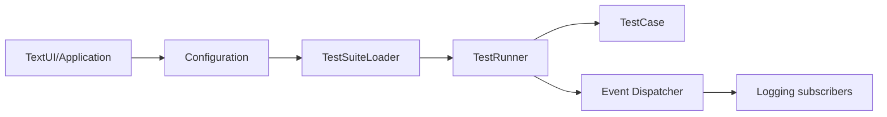

# sebastianbergmann/phpunit

> xUnit-style PHP unit testing framework, used from the command line.

## The problem
Checking PHP code automatically and reproducibly.

## What it actually does
A command-line application loads the configuration (CLI or XML), builds a test suite, runs it in-process or isolated, and publishes events. Subscribers write the logs (JUnit, TeamCity, TestDox), the results cache, and coverage. Distributed as a PHAR or via Composer.

## How it is wired


## Trying it
```bash
wget https://phar.phpunit.de/phpunit-X.Y.phar
php phpunit-X.Y.phar --version
```
(Replace `X.Y` with the desired version.)

## Cost and gotchas
Free. The README mostly lists dependent components, with no usage guide: everything is in the online manual.

## What it is not
Not a data/AI tool: a PHP testing framework.

## Alternatives
None named in the README.

## For you
Ignore: irrelevant if you don't write PHP.
