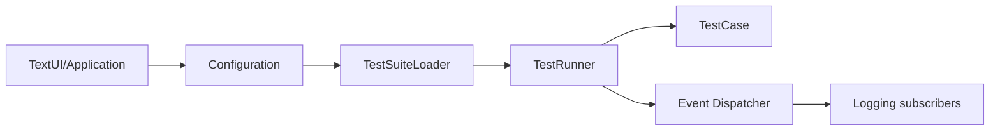

# sebastianbergmann/phpunit

> Framework de tests unitaires PHP de type xUnit, utilisé en ligne de commande.

## Le problème
Vérifier du code PHP automatiquement et de façon reproductible.

## Ce que ça fait vraiment
Une application en ligne de commande charge la configuration (CLI ou XML), construit une suite de tests, l'exécute en processus ou isolé, et publie des événements. Des abonnés écrivent les journaux (JUnit, TeamCity, TestDox), le cache de résultats, la couverture. Distribué en PHAR ou via Composer.

## Comment c'est branché


## Essayer
```bash
wget https://phar.phpunit.de/phpunit-X.Y.phar
php phpunit-X.Y.phar --version
```
(Remplacer `X.Y` par la version voulue.)

## Coût et pièges
Gratuit. Le README liste surtout les composants dépendants, sans guide d'usage : tout est dans le manuel en ligne.

## Ce que ce n'est pas
Pas un outil data/IA : un framework de test PHP.

## Alternatives
Aucune nommée dans le README.

## Pour toi
Ignorer : sans objet si tu n'écris pas de PHP.

