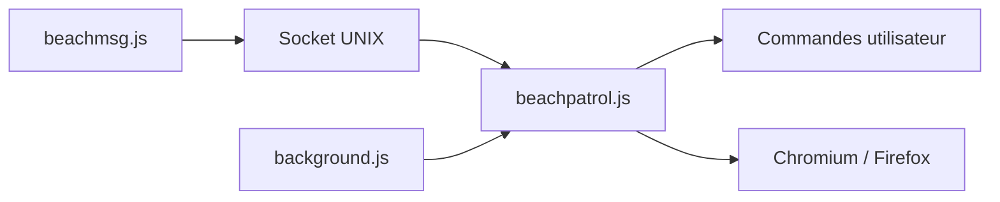

# sebastiancarlos/beachpatrol

> CLI that launches a Chromium or Firefox browser drivable by Playwright scripts, to automate everyday browsing.

## The problem
Browsers are hard to automate from the shell: Playwright is for testing and scraping, not for everyday use.

## What it actually does
`beachpatrol` launches a browser with a persistent profile and listens on a UNIX socket. `beachmsg <command>` runs a Playwright script from `$XDG_DATA_HOME/beachpatrol/commands/` on the active tab or another one, with streamed output. Patchright and stealth plugins hide the automation. The browser extension is not published.

## How it is wired


## Trying it
```bash
git clone https://github.com/sebastiancarlos/beachpatrol
cd beachpatrol
npm install
make
beachmsg smoke-test
```

## Cost and gotchas
Free. Node.js 22. Alpha: unstable API. The detection-evasion plugins may stop working; respect the sites' terms of use.

## What it is not
Not a large-scale scraping framework; the interface extension is not shipped. Active-tab detection is missing under Firefox.

## Alternatives
The README compares it with Selenium, bookmarklets, Violentmonkey and TabFS.

## For you
Worth watching: handy for automating web tasks from scripts, but alpha; for a browser agent, look at Playwright alone first.
