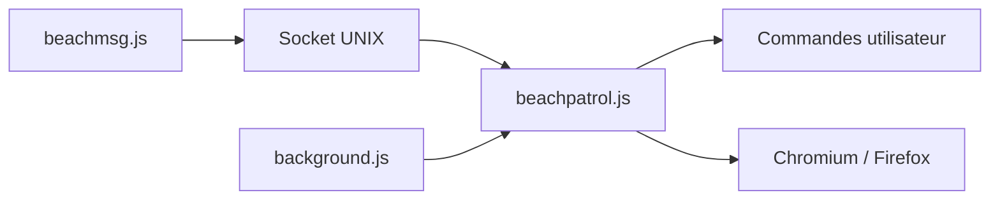

# sebastiancarlos/beachpatrol

> CLI qui lance un navigateur Chromium ou Firefox pilotable par scripts Playwright, pour automatiser son usage quotidien.

## Le problème
Les navigateurs s'automatisent mal depuis le shell : Playwright sert aux tests et au scraping, pas à l'usage quotidien.

## Ce que ça fait vraiment
`beachpatrol` lance un navigateur avec profil persistant et écoute sur un socket UNIX. `beachmsg <commande>` exécute un script Playwright de `$XDG_DATA_HOME/beachpatrol/commands/` sur l'onglet actif ou un autre, avec sortie en flux. Plugins patchright et stealth pour masquer l'automatisation. Extension navigateur non publiée.

## Comment c'est branché


## Essayer
```bash
git clone https://github.com/sebastiancarlos/beachpatrol
cd beachpatrol
npm install
make
beachmsg smoke-test
```

## Coût et pièges
Gratuit. Node.js 22. Alpha : API instable. Les plugins de contournement de détection peuvent cesser de fonctionner ; respecter les conditions des sites.

## Ce que ce n'est pas
Pas un framework de scraping à grande échelle ; l'extension de l'interface n'est pas livrée. Détection de l'onglet actif absente sous Firefox.

## Alternatives
Le README compare à Selenium, aux bookmarklets, à Violentmonkey et TabFS.

## Pour toi
À surveiller : pratique pour automatiser des tâches web depuis des scripts, mais alpha ; pour de l'agent navigateur, regarde d'abord Playwright seul.

