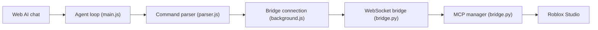

# sebattfg/ZeroScript-Free

> Browser extension that turns a web AI chat (ChatGPT, DeepSeek, Gemini…) into an agent for Roblox Studio.

## The problem
Driving Roblox Studio with an AI normally requires an API key or a paid tool.

## What it actually does
- The extension plugs into eight chats (DeepSeek recommended, ChatGPT, Gemini, Kimi, GLM, Qwen, Arena, Meta AI) and turns replies into commands.
- A local Bridge (Python) forwards these commands to Roblox Studio's built-in MCP server.
- The AI can read and modify scripts, run Luau, inspect the game tree, generate meshes, drive play-testing, and keep a project memory.
- Gemini and Kimi are flagged as unstable.

## How it is wired


## Trying it
```bash
# No shell command in the provided README. Steps:
# 1. Download the zip from Releases, extract it.
# 2. edge://extensions or chrome://extensions > Developer mode > Load unpacked > zeroscript-extension
# 3. Studio: Assistant AI > Manage MCP Servers > Enable Studio as MCP Server
# 4. Windows: start.bat ; macOS: MacOS_Start.command
```

## Cost and gotchas
Free, no API key, but requires an account on the chosen chat and Python 3.9+; Windows or macOS, Edge or Chrome. The README warns against paid copies impersonating the name.

## What it is not
Not an API: it relies on the chats' web interface, which can change (versions 1.5.3 to 1.5.5 fix breakages). GPL-3.0 license (copyleft).

## Alternatives
Lemonade.gg and Luamotion (presented as paid equivalents).

## For you
To ignore: Roblox-specific and fragile (depends on chat interfaces), unrelated to data/AI/MLOps.
