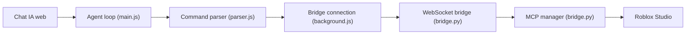

# sebattfg/ZeroScript-Free

> Extension de navigateur qui transforme un chat IA web (ChatGPT, DeepSeek, Gemini…) en agent pour Roblox Studio.

## Le problème
Piloter Roblox Studio avec une IA demande normalement une clé d'API ou un outil payant.

## Ce que ça fait vraiment
- L'extension s'insère dans huit chats (DeepSeek recommandé, ChatGPT, Gemini, Kimi, GLM, Qwen, Arena, Meta AI) et transforme les réponses en commandes.
- Un Bridge local (Python) transmet ces commandes au serveur MCP intégré de Roblox Studio.
- L'IA peut lire et modifier des scripts, exécuter du Luau, inspecter l'arbre du jeu, générer des maillages, piloter le play-test, garder une mémoire de projet.
- Gemini et Kimi sont signalés instables.

## Comment c'est branché


## Essayer
```bash
# Pas de commande shell dans le README fourni. Étapes :
# 1. Télécharger le zip depuis Releases, extraire.
# 2. edge://extensions ou chrome://extensions > Developer mode > Load unpacked > zeroscript-extension
# 3. Studio : Assistant AI > Manage MCP Servers > Enable Studio as MCP Server
# 4. Windows : start.bat ; macOS : MacOS_Start.command
```

## Coût et pièges
Gratuit, sans clé d'API, mais il faut un compte sur le chat choisi et Python 3.9+ ; Windows ou macOS, Edge ou Chrome. Le README alerte contre des copies payantes usurpant le nom.

## Ce que ce n'est pas
Pas une API : il s'appuie sur l'interface web des chats, qui peut changer (versions 1.5.3 à 1.5.5 corrigent des cassures). Licence GPL-3.0 (copyleft).

## Alternatives
Lemonade.gg et Luamotion (présentés comme les équivalents payants).

## Pour toi
À ignorer : spécifique à Roblox et fragile (dépend des interfaces de chats), sans lien avec data/IA/MLOps.

