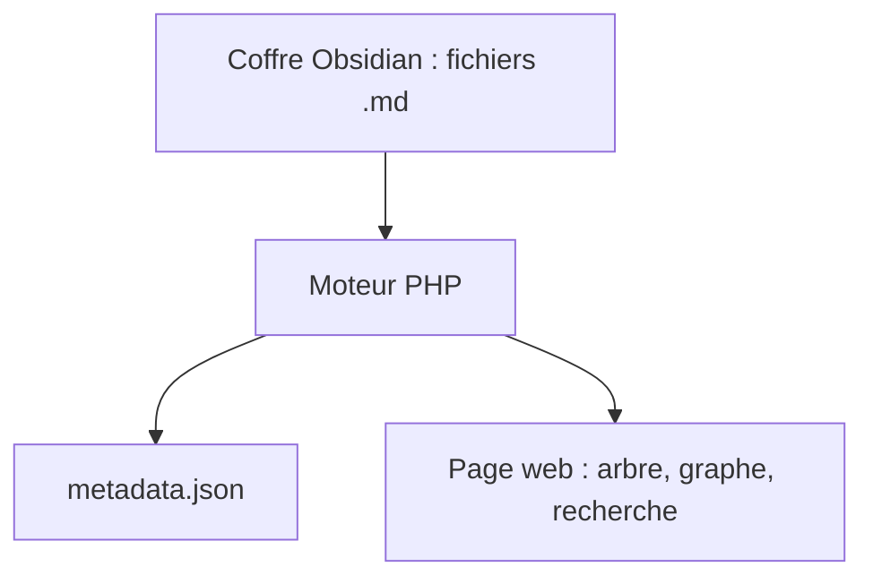

# secure-77/Perlite

> Web viewer for Obsidian vaults, written in PHP, a free alternative to Obsidian Publish.

## The problem
Publishing an Obsidian vault on the web requires either the paid Obsidian Publish or a manual conversion of the notes.

## What it actually does
You drop your vault into the web directory and the page builds itself, with no database. It handles Obsidian themes, an interactive graph, search, tags, links, LaTeX, Mermaid and canvas, in light or dark mode. Rendering is done on the PHP side.

## How it is wired
Simplified diagram based on the sheet, no diagram provided.

## Trying it
The README gives no command: installation points to the documentation (Docker or non-Docker installation) or to a downloadable release.

## Cost and gotchas
Free, but you must secure it yourself: block direct access to the .md files and to `metadata.json`, which reflects the whole structure of the vault, including the excluded parts.

## What it is not
Not an editor or a sync tool. Parsedown's safe mode is on, but the author advises against any untrusted input.

## Alternatives
No alternative named in the README, apart from Obsidian Publish, whose free equivalent it aims to be.

## For you
Keep an eye on it: handy for publishing technical notes, but with no direct link to data or AI, and a single maintainer.
