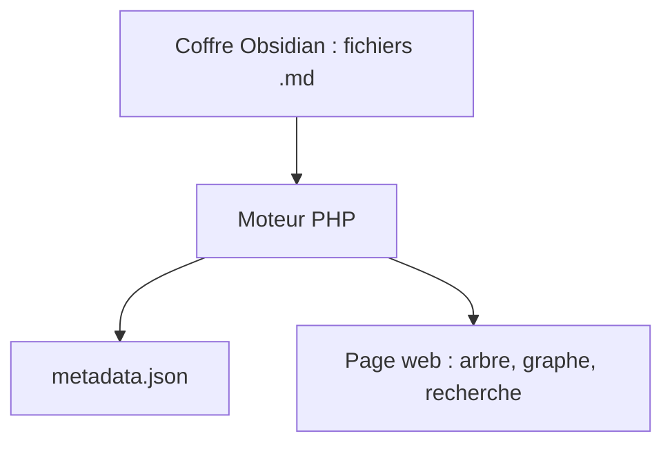

# secure-77/Perlite

> Visionneuse web de coffres Obsidian, en PHP, alternative libre à Obsidian Publish.

## Le problème
Publier un coffre Obsidian sur le web demande soit Obsidian Publish payant, soit une conversion manuelle des notes.

## Ce que ça fait vraiment
Tu déposes ton coffre dans le répertoire web, la page se construit toute seule, sans base de données. Elle gère thèmes Obsidian, graphe interactif, recherche, tags, liens, LaTeX, Mermaid et canvas, en clair ou sombre. Le rendu est fait côté PHP.

## Comment c'est branché
Schéma simplifié d'après la fiche, sans diagramme fourni.

## Essayer
Aucune commande n'est donnée dans le README : l'installation renvoie à la documentation (Docker ou installation sans Docker) ou à une release téléchargeable.

## Coût et pièges
Gratuit, mais à sécuriser soi-même : empêcher l'accès direct aux fichiers .md et à `metadata.json`, qui reflète toute la structure du coffre, y compris les parties exclues.

## Ce que ce n'est pas
Pas un éditeur ni une synchronisation. Le mode sûr de Parsedown est actif, mais l'auteur déconseille toute saisie non fiable.

## Alternatives
Aucune alternative nommée dans le README, hormis Obsidian Publish dont il se veut l'équivalent libre.

## Pour toi
À surveiller : pratique pour publier des notes techniques, mais sans lien direct avec la data ou l'IA, et avec un mainteneur unique.

