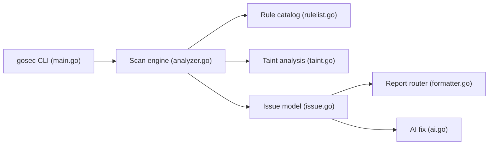

# securego/gosec

> Security scanner for Go code, analyzing the AST and SSA, for developers and CI.

## The problem
Common Go flaws (injection, path traversal, weak crypto) go unnoticed in code review.

## What it actually does
Pattern rules (G1xx to G6xx), SSA analyzers (conversions, slice bounds, crypto) and taint analysis (G7xx: SQL, commands, SSRF, XSS…). Each alert is mapped to a CWE. Outputs: text, json, yaml, csv, junit-xml, html, sonarqube, golint, sarif. `#nosec` annotations. Optional AI fix suggestions.

## How it is wired


## Trying it
```bash
go install github.com/securego/gosec/v2/cmd/gosec@latest
gosec ./...
gosec -fmt sarif -out results.sarif ./...
```

## Cost and gotchas
Free; Go 1.25+. The AI fix mode sends code to an external provider with your API key. False positives to handle via `#nosec`.

## What it is not
Neither a dependency scanner nor a multi-language tool: Go only. Not proof of the absence of flaws.

## Alternatives
None named in the README.

## For you
Adopt it as soon as you have Go code (operators, MLOps tools): CI and SARIF integration costs almost nothing.
