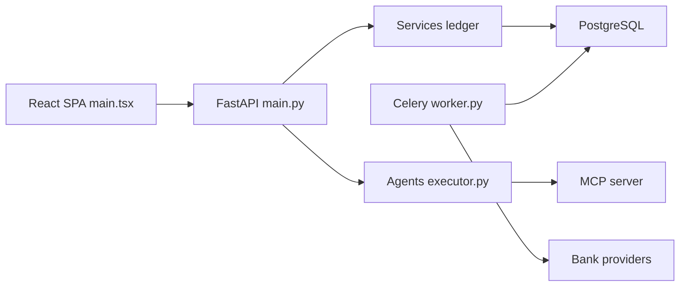

# securo-finance/securo

> Self-hosted personal finance manager, with bank synchronization and optional AI agents.

## The problem
Budgeting apps centralize your banking data with a third party.

## What it actually does
FastAPI, PostgreSQL, Celery/Redis and a React front end. Accounts, transactions (OFX, QIF, CAMT, CSV import), categorization rules, budgets, goals, assets, reports, multi-currency and multi-user. Synchronization via Pluggy (Brazil), Enable Banking (PSD2) or SimpleFIN. Local authentication, TOTP, passkeys and OIDC. AI agents (OpenAI, Anthropic, Ollama) query the data through a built-in MCP server and a RAG knowledge base.

## How it is wired


## Trying it
```bash
curl -fsSL https://usesecuro.com/install.sh | bash
git clone https://github.com/securo-finance/securo.git && cd securo
docker compose up --build
# http://localhost:3000
```

## Cost and gotchas
Free when self-hosted. Bank synchronization requires an account with a provider; Enable Banking requires HTTPS, and its free tier requires linking accounts manually. Agents are disabled by default. 237 open issues.

## What it is not
Not a data or ML tool: an end-user application. The README states that part of the code was written with AI assistance, reviewed by humans. AGPL-3.0: publication obligations if you expose it as a service.

## Alternatives
No alternative is cited in the README.

## For you
Ignore for your line of work: a good personal app, but unrelated to the data/AI pipeline and under AGPL.
