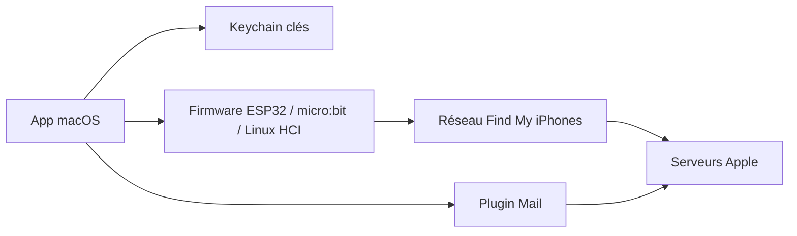

# seemoo-lab/openhaystack

> Research-born framework for tracking personal Bluetooth devices through Apple's Find My network.

## The problem
Commercial trackers are closed; this project documents and reuses how the Find My network works.

## What it actually does
A macOS app generates key pairs (P-224), the public key is deployed to a micro:bit, an ESP32 or a Linux machine that emits BLE advertisements. Nearby iPhones upload encrypted locations; the app downloads them and decrypts them with the private key from the keychain. An Apple Mail plugin provides authentication. A Flutter mobile version exists, with a proxy server on a Mac.

## How it is wired


## Trying it
```bash
sudo spctl --master-disable
sudo defaults write "/Library/Preferences/com.apple.mail" EnableBundles 1
sudo spctl --master-enable
```
These README commands are used to enable the Mail plugin; the app is downloaded as a binary or built with Xcode.

## Cost and gotchas
Requires macOS 11, temporarily disabling Gatekeeper, and an Apple account. The firmware emits a fixed key: the beacons can be tracked by others. Software is "experimental, untested" according to the author.

## What it is not
Not affiliated with Apple. Using the fixed key exposes you to third-party tracking.

## Alternatives
No alternative cited in the README.

## For you
Worth watching: interesting as a security and encryption case study, but fragile and with no direct data/AI use.
