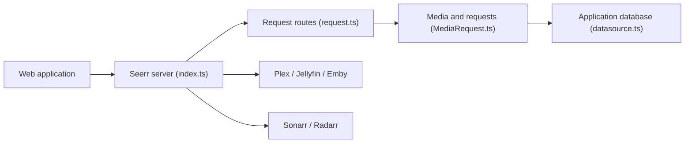

# seerr-team/seerr

> Media request management application, connected to Jellyfin, Plex, Emby, Sonarr and Radarr.

## The problem
Users of a personal media library request movies and series with no clear channel; the admin has to track everything by hand.

## What it actually does
Web interface to discover titles via TMDB, request movies or seasons, and approve requests. It imports users from the media server, scans libraries, sends requests to Sonarr/Radarr, manages permissions, watch and block lists, notifications. PostgreSQL or SQLite database.

## How it is wired

## Trying it
The README points to https://docs.seerr.dev/getting-started/ and gives no command. No command documented.

## Cost and gotchas
Free. You need a media server and usually Sonarr/Radarr. Migration from Overseerr/Jellyseerr documented separately.

## What it is not
Not a media server nor a downloader: it forwards requests to the other tools.

## Alternatives
- Overseerr and Jellyseerr: the projects of which Seerr is the successor.

## For you
Ignore: home media library tool, unrelated to data/AI/MLOps.
