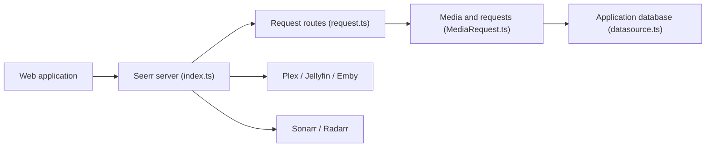

# seerr-team/seerr

> Application de gestion des demandes de médias, branchée sur Jellyfin, Plex, Emby, Sonarr et Radarr.

## Le problème
Les utilisateurs d'une médiathèque perso demandent films et séries sans canal clair ; l'admin doit tout suivre à la main.

## Ce que ça fait vraiment
Interface web pour découvrir des titres via TMDB, demander films ou saisons, et approuver les demandes. Elle importe les utilisateurs du serveur média, scanne les bibliothèques, envoie les demandes à Sonarr/Radarr, gère permissions, listes de suivi et de blocage, notifications. Base PostgreSQL ou SQLite.

## Comment c'est branché

## Essayer
Le README renvoie à https://docs.seerr.dev/getting-started/ et ne donne aucune commande. Aucune commande documentée.

## Coût et pièges
Gratuit. Il faut un serveur média et en général Sonarr/Radarr. Migration depuis Overseerr/Jellyseerr documentée à part.

## Ce que ce n'est pas
Pas un serveur média ni un téléchargeur : il transmet les demandes aux autres outils.

## Alternatives
- Overseerr et Jellyseerr : les projets dont Seerr est le successeur.

## Pour toi
Ignorer : outil de médiathèque domestique, sans lien avec la data/IA/MLOps.

