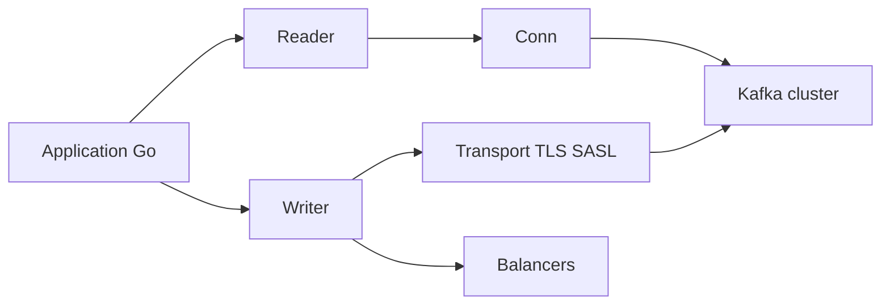

# segmentio/kafka-go

> Go client for Apache Kafka, with low-level and high-level APIs that follow standard library conventions.

## The problem
Existing Go clients were judged difficult (sarama), dependent on a C library (confluent-kafka-go) or too specialized (goka).

## What it actually does
Low-level `Conn` type, `Reader` with reconnection, offset management, consumer groups and explicit commits, `Writer` with retries, balancers (Hash, LeastBytes, CRC32, Murmur2) and compression (Snappy). It handles TLS and SASL (Plain, SCRAM), Go context, and a configurable logger. The README gives equivalents for the partitioners of Sarama, librdkafka and the Java client.

## How it is wired


## Trying it
```bash
docker-compose up -d
KAFKA_VERSION=2.3.1 KAFKA_SKIP_NETTEST=1 go test -race ./...
```
These are the test commands; usage is given as Go examples in the README.

## Cost and gotchas
Free, but a Kafka cluster is needed. Tested with Kafka 0.10.1.0 to 2.7.1 and Go 1.15+: newer Kafka features may be missing. `kafka.NewWriter` and `WriterConfig` are announced as deprecated. The `Reader` must be closed when the process stops.

## What it is not
It is not a Python client nor a stream framework: it is a Go client. The limits of consumer groups (no `SetOffset`, `Lag` at -1) are documented.

## Alternatives
sarama: more widespread, low-level API. confluent-kafka-go: richer documentation, but depends on librdkafka via cgo. goka: message bus abstraction, depends on sarama.

## For you
Ignore if your stack is Python; keep in mind only for Go services that read from or write to Kafka.
