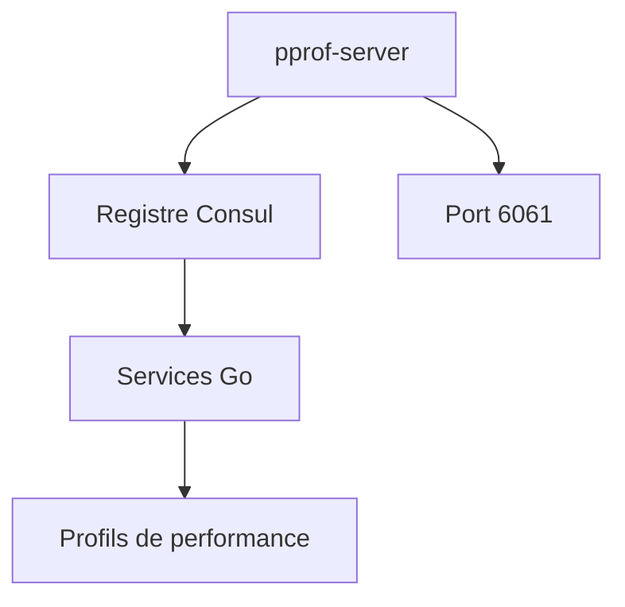

# segmentio/pprof-server

> Web server exposing the performance profiles of Go services, for teams that operate them.

## The problem
Retrieving the pprof profiles of many Go services requires knowing the address of each one.

## What it actually does
A web server that relies on a Consul registry to reach the Go services. The README is minimal: it describes neither the routes nor the format of the profiles.

## How it is wired
Simplified diagram based on the fiche, no diagram provided.



## Trying it
```bash
govendor sync
go build ./cmd/pprof-server
./pprof-server -registry consul://localhost:8500
docker run -it --rm -p 6061:6061 segment/pprof-server -registry consul://172.17.0.1:8500
```

## Cost and gotchas
Free, but you need Go (govendor, an old dependency tool) and an accessible Consul registry.

## What it is not
Not a profiler: it presents existing profiles. Undocumented beyond launching it.

## Alternatives
None cited in the README.

## For you
Ignore: archived, poorly documented and centered on Go and Consul.
