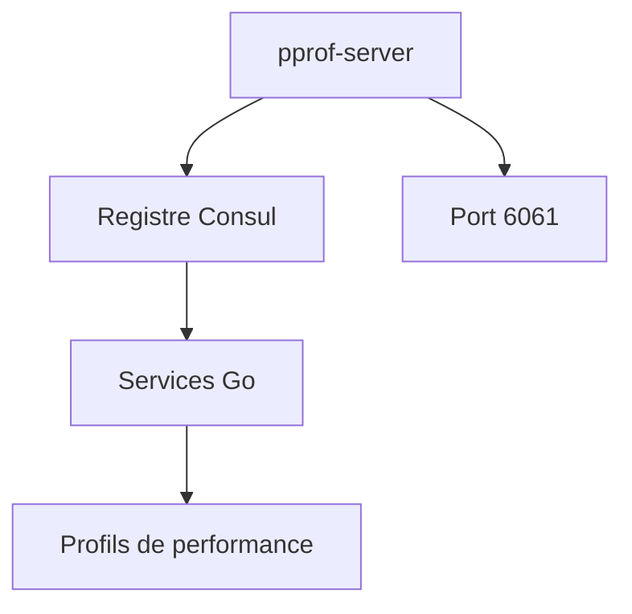

# segmentio/pprof-server

> Serveur web exposant les profils de performance de services Go, pour équipes qui les exploitent.

## Le problème
Récupérer les profils pprof de nombreux services Go demande de connaître l'adresse de chacun.

## Ce que ça fait vraiment
Un serveur web qui s'appuie sur un registre Consul pour atteindre les services Go. Le README est minimal : il ne décrit ni les routes ni le format des profils.

## Comment c'est branché
Schéma simplifié d'après la fiche, sans diagramme fourni.



## Essayer
```bash
govendor sync
go build ./cmd/pprof-server
./pprof-server -registry consul://localhost:8500
docker run -it --rm -p 6061:6061 segment/pprof-server -registry consul://172.17.0.1:8500
```

## Coût et pièges
Gratuit, mais il faut Go (govendor, ancien outil de dépendances) et un registre Consul accessible.

## Ce que ce n'est pas
Pas un profileur : il présente les profils existants. Non documenté au-delà du lancement.

## Alternatives
Aucune citée dans le README.

## Pour toi
À ignorer : archivé, mal documenté et centré sur Go et Consul.

