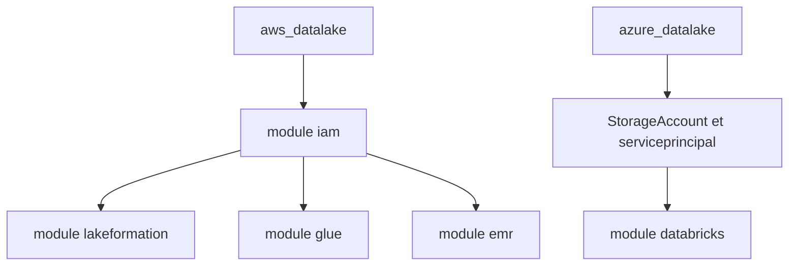

# segmentio/terraform-segment-data-lakes

> Terraform modules that create the AWS or Azure resources of a Segment data lake.

## The problem
Connecting Segment Data Lakes to your own cloud requires IAM, governance, catalog and compute to be set up correctly.

## What it actually does
Two independent roots. On the AWS side: `iam`, `lakeformation`, `glue` and `emr` modules. On the Azure side: `StorageAccount`, `serviceprincipal`, `databricks` and `mysql`. Each module has its `main.tf`, `variables.tf` and `output.tf`. Buildkite CI runs Test Kitchen (Ruby) tests on fixtures.

## How it is wired

## Trying it
The README points to the guides in the `aws_datalake` and `azure_datalake` folders; no commands appear in it.

## Cost and gotchas
An AWS or Azure account is required, plus a Segment account with Data Lakes. EMR, Glue and Databricks bill by usage. The README targets Terraform 0.12 and warns about AWS provider versions. Changes to `externalID` go through Segment support.

## What it is not
Not data pipelines: only the base infrastructure. Useless without Segment.

## Alternatives
No alternative named in the README.

## For you
Worth watching: a good example of a governed data lake on AWS (Lake Formation, Glue, EMR), but tied to Segment.
