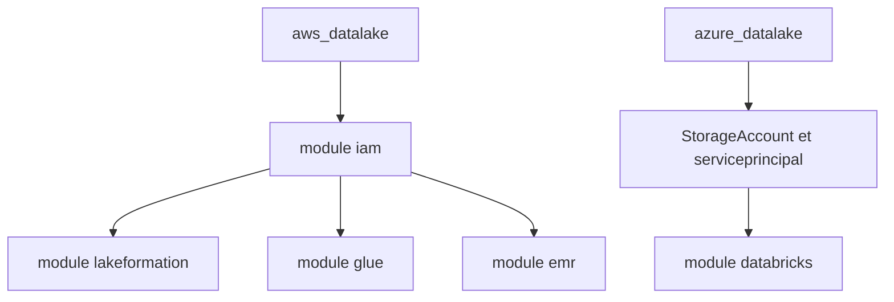

# segmentio/terraform-segment-data-lakes

> Modules Terraform qui créent les ressources AWS ou Azure d'un data lake Segment.

## Le problème
Brancher Segment Data Lakes à son propre cloud exige IAM, gouvernance, catalogue et calcul correctement montés.

## Ce que ça fait vraiment
Deux racines indépendantes. Côté AWS : modules `iam`, `lakeformation`, `glue` et `emr`. Côté Azure : `StorageAccount`, `serviceprincipal`, `databricks` et `mysql`. Chaque module a ses `main.tf`, `variables.tf` et `output.tf`. La CI Buildkite lance des tests Test Kitchen (Ruby) sur des fixtures.

## Comment c'est branché

## Essayer
Le README renvoie aux guides des dossiers `aws_datalake` et `azure_datalake` ; aucune commande n'y figure.

## Coût et pièges
Compte AWS ou Azure requis, et un compte Segment avec Data Lakes. EMR, Glue et Databricks facturent à l'usage. Le README cible Terraform 0.12 et avertit sur les versions du provider AWS. Les modifications d'`externalID` passent par le support Segment.

## Ce que ce n'est pas
Pas des pipelines de données : seulement l'infrastructure de base. Inutile sans Segment.

## Alternatives
Aucune alternative nommée dans le README.

## Pour toi
À surveiller : bon exemple de lac de données gouverné sur AWS (Lake Formation, Glue, EMR), mais lié à Segment.

