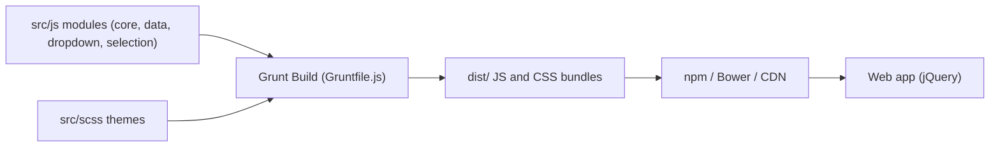

# select2/select2

> jQuery plugin that replaces HTML dropdown lists with lists offering search, tags, and remote loading.

## The problem
Native select elements offer no search, no pleasant multiple selection, and no paginated loading of large datasets.

## What it actually does
Enhances a `<select>` with search, tags, nested optgroups, rendering templates, and data loaded through AJAX with pagination. The modules are separate: core, data (ajax, array, tags adapters), dropdown, selection, and i18n. The Grunt build produces bundles in `dist/` with a UMD wrapper; SCSS themes (classic, default) and many third-party integrations are listed.

## How it is wired

## Trying it
The README gives no command; it offers a CDN (jsDelivr, cdnjs), a download from the releases, and points to select2.org.

## Cost and gotchas
Free. Depends on jQuery. The stated compatibility goes back to IE 8+ and Chrome 8+, a sign of an old project. A language is added by including the right i18n file.

## What it is not
It is not a React or Vue component: it is a jQuery plugin, and integrations come from third parties.

## Alternatives
- No alternative named in the README.

## For you
Ignore: a jQuery form library, unrelated to data or AI; useful only for maintaining an old front end.
