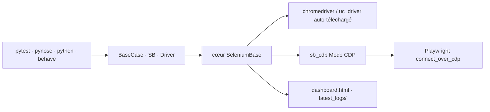

# seleniumbase/SeleniumBase

> Python end-to-end browser testing framework, with CDP and Playwright stealth modes.

## The problem
Raw Selenium fails as soon as an element takes time to load, and every explicit wait adds three
lines of code.

## What it actually does
SeleniumBase wraps Selenium with methods that wait by default: `self.click(sel)` replaces
`WebDriverWait(driver, 10).until(...)`. Three syntaxes coexist — the `BaseCase` class, the `SB()`
context manager, and `Driver()` — runnable by pytest, pynose, plain python or behave. CDP mode
(`sb_cdp`) bypasses bot detection on Chromium browsers and the stealth Playwright mode extends that
stealth to Playwright by connecting to it through CDP. The `sbase` CLI generates files and projects,
records browser actions as code (`mkrec`, `--recorder`), downloads webdrivers, and produces
dashboards and HTML reports. An MCP server, `seleniumbase-mcp`, is available.

## How it is wired


## Trying it
```bash
pip install seleniumbase
pip install playwright
pytest my_first_test.py
pytest test_coffee_cart.py --demo
pytest test_suite.py --rs --html=report.html --dashboard
sbase get chromedriver stable
```

## Cost and gotchas
Free. Chrome is the default browser; only unbranded Chromium and Chrome-for-Testing are downloaded
automatically. `--pdb`, `--trace` and `--ftrace` are explicitly discouraged in CI. The options
`--disable-cookies`, `--disable-js`, `--disable-csp` can break pages.

## What it is not
It is not a neutral tool: bot-detection bypass and `sb.solve_captcha()` are highlighted from the
very first line of the README. On a third-party site, this use falls under its terms of service. Nor
is it a replacement for Playwright: the two modes coexist, with SeleniumBase providing the stealth
session that Playwright connects to.

## Alternatives
The README only compares against raw Selenium, showing the code saved line by line; Playwright
appears there as an optional integration, not as a competitor.

## For you
Useful for testing an internal interface or collecting from a site you control; the anti-detection
features require you to be sure of your legal framework before use.
