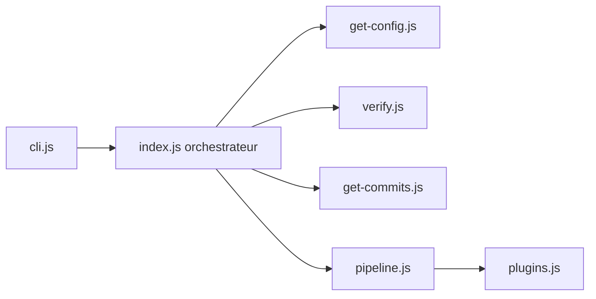

# semantic-release/semantic-release

> Automates versioning, release notes and package publishing on every successful CI build.

## The problem
Version numbers and releases done by hand are arbitrary, forgotten or wrong.

## What it actually does
Reads commit messages (Angular convention by default), computes the next semver version, generates the notes, creates the Git tag then publishes via plugins. Runs on the CI of the release branch. Supports distribution channels, pre-releases and signed npm provenance.

## How it is wired


## Trying it
No installation command in the README; only the badge is documented.
```md
[](https://github.com/semantic-release/semantic-release)
```

## Cost and gotchas
Free. Requires a Git repository, a CI with secrets, and compliant Git and Node versions. Commits must follow the convention, otherwise no release.

## What it is not
Not an interactive local tool: it is designed for CI. Nor is it a generator of compliant commits (see commitizen/commitlint).

## Alternatives
- commitizen / commitlint: to help write and enforce the commit format, not to publish.

## For you
Adopt it to publish internal packages or tools without manual steps, provided you enforce the commit convention on the team.
