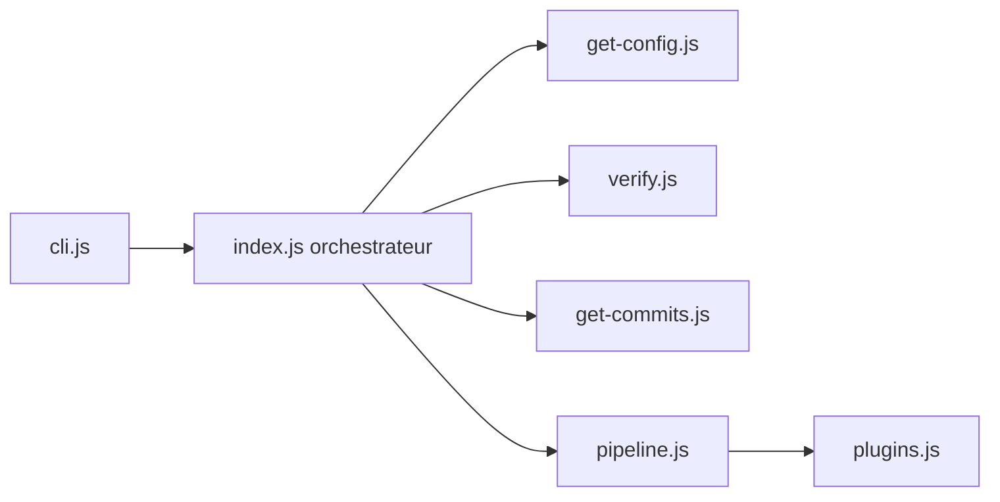

# semantic-release/semantic-release

> Automatise versionnage, notes de version et publication d'un paquet à chaque build CI réussi.

## Le problème
Les numéros de version et les releases faits à la main sont arbitraires, oubliés ou erronés.

## Ce que ça fait vraiment
Lit les messages de commit (convention Angular par défaut), calcule la prochaine version semver, génère les notes, crée le tag Git puis publie via des plugins. Tourne sur la CI de la branche de release. Supporte canaux de distribution, pré-releases et provenance npm signée.

## Comment c'est branché


## Essayer
Aucune commande d'installation dans le README ; seul le badge est documenté.
```md
[](https://github.com/semantic-release/semantic-release)
```

## Coût et pièges
Gratuit. Exige un dépôt Git, une CI avec secrets, des versions Git et Node conformes. Les commits doivent suivre la convention, sinon aucune release.

## Ce que ce n'est pas
Pas un outil local interactif : il est pensé pour la CI. Ce n'est pas non plus un générateur de commits conformes (voir commitizen/commitlint).

## Alternatives
- commitizen / commitlint : pour aider à écrire et imposer le format des commits, pas pour publier.

## Pour toi
À adopter pour publier des paquets ou outils internes sans geste manuel, à condition d'imposer la convention de commits à l'équipe.

