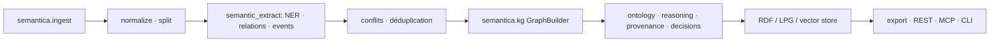

# semantica-agi/semantica

> Graph semantic layer for agents: context, deterministic reasoning and traceability.

## The problem
An agent backed by embeddings returns similarities without structure or relations, and cannot explain why a result surfaced.

## What it actually does
Semantica builds a Context Graph and a knowledge graph from enterprise data, with no LLM required for construction, reasoning or provenance. Each decision (`record_decision`) becomes a queryable node, causally linked (`add_causal_relationship`), with precedent search, causal chain tracing, impact map and compliance check. W3C PROV-O provenance exports to JSON, CSV or RDF. Reasoning is deterministic: forward chaining, Rete network, Datalog, SPARQL. Storage is polyglot (RDF: Oxigraph, Blazegraph, Jena, RDF4J; LPG: Neo4j, FalkorDB, AGE, Neptune) and vector stores are interchangeable.

## How it is wired


## Trying it
```bash
pip install semantica
semantica doctor
```
```python
from semantica.context import ContextGraph
graph = ContextGraph(advanced_analytics=True)
decision_id = graph.record_decision(category="vendor_selection", scenario="...", reasoning="...", outcome="selected_aws", confidence=0.93)
chain = graph.trace_decision_chain(decision_id)
```

## Cost and gotchas
The package is free and no license is declared in the README. Enterprise connectors (Databricks, Snowflake, SAP) are installed through extras and involve accounts and credentials; the README itself reminds you never to hard-code `token`, `password` or `private_key`. Some ingesters (DuckDB, Elasticsearch, Google Drive, HuggingFace, MongoDB, Pandas) exist but are not re-exported from `semantica.ingest` — direct import required.

## What it is not
The README states it: this is not foundation-model explainability. The LLM's internal reasoning remains opaque; Semantica explains what is *around* it — the context provided, the decision produced, provenance, policies applied. Nor is it a replacement for your stack: the LLM, vector store and agent framework stay in place.

## Alternatives
The README only compares against two categories: "Vector DB + RAG" and "raw LLM memory", without naming any competing project.

## For you
The product pitch is dense and the README is truncated midway: evaluate it on a real regulatory traceability case before committing to anything.
