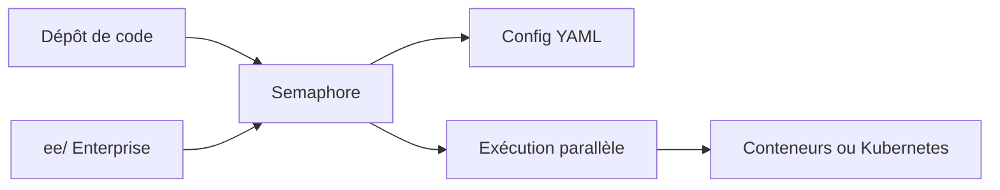

# semaphoreio/semaphore

> Self-hostable CI/CD platform in a community edition, for teams that want to control their pipeline.

## The problem
Hosted CI/CD pipelines are expensive at scale and lock you into a vendor; sometimes everything must be kept in-house.

## What it actually does
Runs pipelines configured in YAML, with parallel execution, on containers, Kubernetes or multi-cloud. The README advertises a 10 to 30 minute installation, following external guides (not detailed in the README). Three tiers: community edition, Enterprise edition (code under a commercial license in `ee/`) and a hosted cloud version.

## How it is wired

Simplified diagram based on the sheet, no diagram provided.

## Trying it
No command in the README: installation goes through the online documentation guides.

## Cost and gotchas
Infrastructure at your expense for self-hosting. Enterprise features are paid and under a commercial license; the license of the rest is not identified by GitHub.

## What it is not
Not a simple lint or build tool: it is a complete platform to operate. The README documents neither architecture nor technical prerequisites.

## Alternatives
No alternative named in the README.

## For you
Worth watching: interesting for hosting an MLOps team's CI, but the unclear license and the Enterprise part require verification before any commitment.
