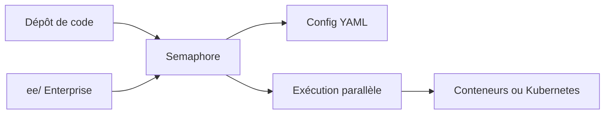

# semaphoreio/semaphore

> Plateforme CI/CD auto-hébergeable en édition communautaire, pour équipes qui veulent maîtriser leur pipeline.

## Le problème
Les pipelines CI/CD hébergés coûtent cher à grande échelle et enferment dans un fournisseur ; il faut parfois tout garder chez soi.

## Ce que ça fait vraiment
Exécute des pipelines configurés en YAML, avec exécution parallèle, sur conteneurs, Kubernetes ou multi-cloud. Le README annonce une installation de 10 à 30 minutes, suivant des guides externes (non détaillés dans le README). Trois formules : édition communautaire, édition Enterprise (code sous licence commerciale dans `ee/`) et version cloud hébergée.

## Comment c'est branché

Schéma simplifié d'après la fiche, sans diagramme fourni.

## Essayer
Aucune commande dans le README : l'installation passe par les guides de la documentation en ligne.

## Coût et pièges
Infrastructure à ta charge pour l'auto-hébergement. Les fonctions Enterprise sont payantes et sous licence commerciale ; la licence du reste n'est pas identifiée par GitHub.

## Ce que ce n'est pas
Pas un simple outil de lint ou de build : c'est une plateforme complète à opérer. Le README ne documente ni architecture ni prérequis techniques.

## Alternatives
Aucune alternative nommée dans le README.

## Pour toi
À surveiller : intéressant pour héberger la CI d'une équipe MLOps, mais la licence floue et la partie Enterprise imposent une vérification avant tout engagement.

