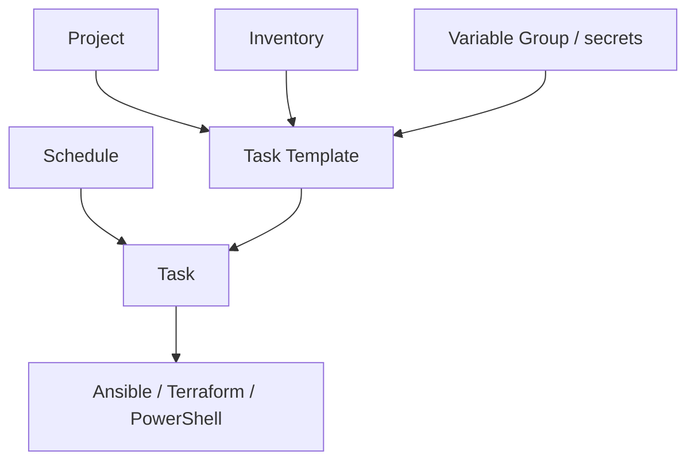

# semaphoreui/semaphore

> Web interface to run and schedule Ansible, Terraform/OpenTofu and PowerShell scripts.

## The problem
When the project grows, deploying from the terminal no longer scales: nobody knows who ran
what, or when, or with which secrets.

## What it actually does
Semaphore exposes a web UI to run Ansible playbooks, Terraform and OpenTofu code, Bash and
PowerShell scripts. It notifies on failure and controls access to the deployment system.
Its model rests on six objects: Projects, Task Templates, Task, Schedules, Inventory and Variable
Group (which holds environment variables and secrets).

## How it is wired


## Trying it
```bash
docker run -p 3000:3000 --name semaphore \
	-e SEMAPHORE_DB_DIALECT=sqlite \
	-e SEMAPHORE_ADMIN=admin \
	-e SEMAPHORE_ADMIN_PASSWORD=changeme \
	-e SEMAPHORE_ADMIN_NAME=Admin \
	-e SEMAPHORE_ADMIN_EMAIL=admin@localhost \
	-d semaphoreui/semaphore:latest
```

## Cost and gotchas
Free. The example admin password is `changeme` — change it before any exposure. The
Variable Groups store secrets: that is the sensitive point of the installation. Docker is the
main route, but Snap, binary and Debian/RPM packages also exist.

## What it is not
It is not an execution engine: Semaphore drives Ansible, Terraform and the like, it does not
replace them. Nor is it a general-purpose CI/CD, and the SaaS section of the README is
commented out — no hosted offering is promoted.

## Alternatives
No competitor named; the README only lists the surrounding ecosystem (Ansible collections
Ebdruplab, SemaphoreUI MCP server, Terraform provider, PSSemaphore module).

## For you
Relevant if you deploy data environments with Ansible or Terraform and want to
trace and schedule runs without setting up a full CI pipeline.
