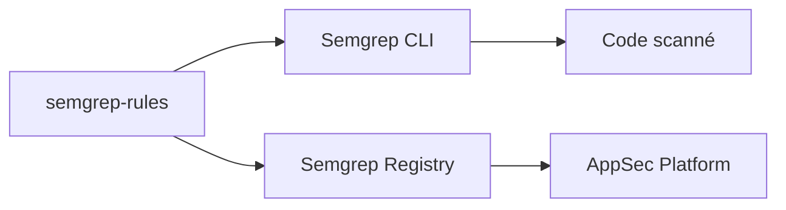

# semgrep/semgrep-rules

> Semgrep Community Edition rules to detect vulnerabilities and bad practices in code.

## The problem
Writing your own security analysis rules takes time and expertise.

## What it actually does
Repository of YAML rules (Community Edition) usable with the Semgrep CLI or in CI. The Pro rules, with cross-file analysis and deep data flow, are separate and offered through the registry. The README points to the documentation on pattern and rule syntax, and to an interactive tutorial.

## How it is wired


## Trying it
```bash
# Aucune commande dans le README : voir la doc Semgrep (syntaxe de règles, CLI).
```

## Cost and gotchas
Community rules are free; Pro rules and the platform are commercial. A license is present but not identified by GitHub: read it before redistributing them.

## What it is not
Not the engine: it is the rule set. The Pro rules are not here.

## Alternatives
The README names no alternative.

## For you
Worth watching: a useful rule base for auditing Python/ML code in CI, provided you check the license.
