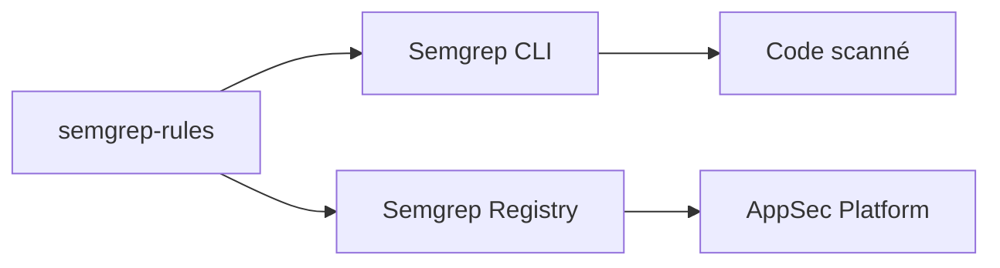

# semgrep/semgrep-rules

> Règles Semgrep de l'édition communautaire pour détecter failles et mauvais usages dans le code.

## Le problème
Écrire soi-même des règles d'analyse de sécurité demande du temps et de l'expertise.

## Ce que ça fait vraiment
Dépôt de règles YAML (Community Edition) utilisables avec la CLI Semgrep ou en CI. Les règles Pro, avec analyse inter-fichiers et flux de données profond, sont séparées et proposées par le registre. Le README renvoie à la documentation de syntaxe de patterns et de règles, et à un tutoriel interactif.

## Comment c'est branché


## Essayer
```bash
# Aucune commande dans le README : voir la doc Semgrep (syntaxe de règles, CLI).
```

## Coût et pièges
Règles communautaires gratuites ; règles Pro et plateforme sont commerciales. Licence présente mais non identifiée par GitHub : à lire avant de les redistribuer.

## Ce que ce n'est pas
Pas le moteur : c'est le jeu de règles. Les règles Pro ne sont pas ici.

## Alternatives
Le README ne nomme pas d'alternative.

## Pour toi
À surveiller : base de règles utile pour auditer du code Python/ML en CI, à condition de vérifier la licence.

