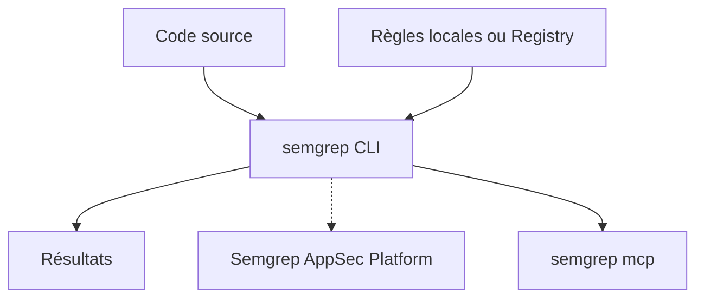

# semgrep/semgrep

> Static analysis tool that searches code for bugs and vulnerabilities by pattern, for developers and security teams.

## The problem
Manual reviews miss recurring mistakes, and rules based on regex or syntax trees are painful to write.

## What it actually does
Searches code with rules that look like the target code, across more than 30 languages, in the IDE, pre-commit or CI. In CI on a pull request, it only flags the problems introduced. The community edition only analyzes at the scale of a function or a file; the rest goes through the AppSec platform. An MCP server exists (`semgrep mcp`).

## How it is wired
Simplified diagram based on the fiche, no diagram provided.



## Trying it
```bash
pipx install semgrep
semgrep login
semgrep ci
semgrep -e '$X == $X' --lang=py path/to/src
```

## Cost and gotchas
Community edition is free; Pro rules, cross-file analysis and the AI Assistant belong to the platform, with free and paid plans. Rules from the Registry send pseudonymized metrics (`--metrics=off` to disable). LGPL-2.1 license.

## What it is not
Not an offensive tool: defensive code analysis. Not a replacement for a full SAST platform in the community edition. Code is not sent by default.

## Alternatives
None named in the README.

## For you
Adopt: a `semgrep ci` adds a low-cost safeguard on Python code or MLOps pipelines, with metrics turned off if needed.
