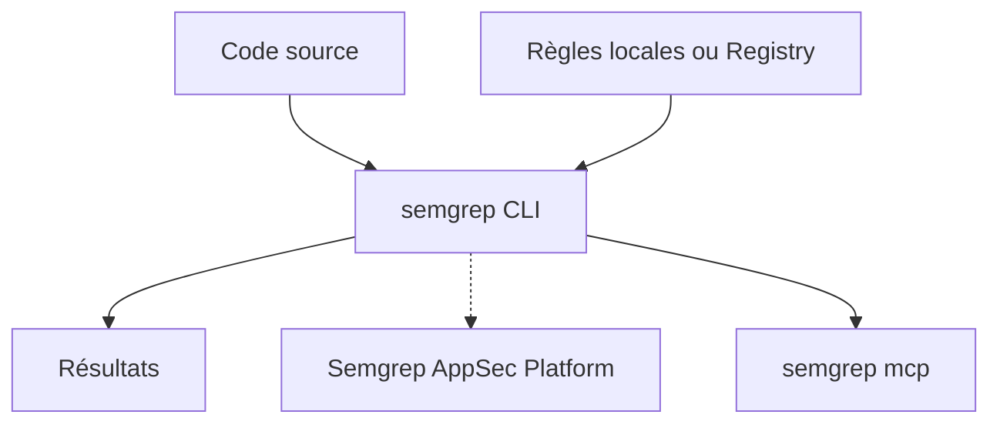

# semgrep/semgrep

> Outil d'analyse statique qui cherche bogues et failles dans le code par motifs, pour développeurs et équipes sécurité.

## Le problème
Les revues manuelles manquent des erreurs récurrentes, et les règles par regex ou arbre syntaxique sont pénibles à écrire.

## Ce que ça fait vraiment
Cherche dans le code avec des règles qui ressemblent au code cible, sur plus de 30 langages, en IDE, pre-commit ou CI. En CI sur une pull request, ne signale que les problèmes introduits. L'édition communautaire n'analyse qu'à l'échelle d'une fonction ou d'un fichier ; le reste passe par la plateforme AppSec. Un serveur MCP existe (`semgrep mcp`).

## Comment c'est branché
Schéma simplifié d'après la fiche, sans diagramme fourni.



## Essayer
```bash
pipx install semgrep
semgrep login
semgrep ci
semgrep -e '$X == $X' --lang=py path/to/src
```

## Coût et pièges
Édition communautaire gratuite ; règles Pro, analyse inter-fichiers et Assistant IA relèvent de la plateforme, avec offres gratuite et payantes. Les règles du Registry envoient des métriques pseudonymisées (`--metrics=off` pour couper). Licence LGPL-2.1.

## Ce que ce n'est pas
Pas un outil offensif : analyse de code défensive. Pas un remplaçant d'une plateforme SAST complète en édition communautaire. Le code n'est pas envoyé par défaut.

## Alternatives
Aucune nommée dans le README.

## Pour toi
À adopter : un `semgrep ci` ajoute un garde-fou sur le code Python ou les pipelines MLOps à faible coût, avec les métriques coupées si besoin.

