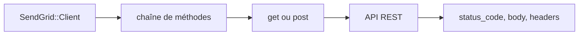

# sendgrid/ruby-http-client

> Generic Ruby client for calling REST APIs, used by the SendGrid library.

## The problem
Calling a REST API in Ruby requires building the URL, headers and body by hand.

## What it actually does
A method chain builds the URL (`client.your.api._(param).call`) then sends `get` or `post` with headers, query parameters and body. The response exposes `status_code`, `body` and `headers`.

## How it is wired
Simplified diagram based on the sheet, no diagram provided.


## Trying it
```bash
gem install ruby_http_client
```

## Cost and gotchas
Ruby 2.4 or later (outside the list, hence `none` not retained in favor of the API key shown in the example). The README mentions `SENDGRID_API_KEY`.

## What it is not
Not the SendGrid client: that one is in another repository.

## Alternatives
- SendGrid library (repository cited in the README): the full client for the SendGrid API.

## For you
Ignore: small Ruby HTTP client, of no interest for a Python data/AI/MLOps profile.
