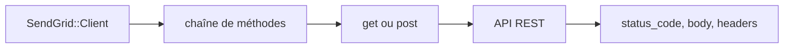

# sendgrid/ruby-http-client

> Client Ruby générique pour appeler des API REST, utilisé par la bibliothèque SendGrid.

## Le problème
Appeler une API REST en Ruby demande de composer URL, en-têtes et corps à la main.

## Ce que ça fait vraiment
Une chaîne de méthodes construit l'URL (`client.your.api._(param).call`) puis envoie `get` ou `post` avec en-têtes, paramètres de requête et corps. La réponse expose `status_code`, `body` et `headers`.

## Comment c'est branché
Schéma simplifié d'après la fiche, sans diagramme fourni.


## Essayer
```bash
gem install ruby_http_client
```

## Coût et pièges
Ruby 2.4 ou plus (hors liste, d'où `aucun` non retenu au profit de la clé d'API affichée dans l'exemple). Le README parle de `SENDGRID_API_KEY`.

## Ce que ce n'est pas
Pas le client SendGrid : celui-ci est dans un autre dépôt.

## Alternatives
- Bibliothèque SendGrid (dépôt cité dans le README) : le client complet de l'API SendGrid.

## Pour toi
À ignorer : petit client HTTP Ruby, sans intérêt pour un profil data/IA/MLOps en Python.

